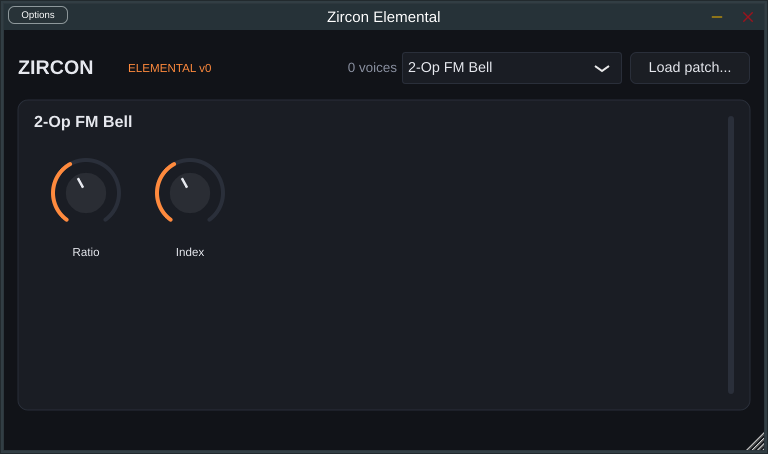

# Zircon Elemental

*Zircon* for the crystal: hard, precise, among the oldest minerals on Earth. *Elemental* for the idea: everything is built from elements, from math primitives up to instruments.

An open-source modular DSP environment in the spirit of **SynC Modular** (Dr SynC, 1999–2003):
build *any* audio software from math primitives, or patch premade modules and macros, then run it
as a VST3 plugin. Planned: modern UI and AI-assisted patch design.

> Clean-room project. Not affiliated with Dr SynC or Native Instruments. No original code is used;
> SynC `.sm` patch import (planned) works from the file format only.



## Status: v0 prototype

| Part | State |
|---|---|
| Graph compiler (macros, feedback detection, summing inputs) | ✅ |
| Voice-parallel runtime (16 lanes, stealing, param smoothing) | ✅ |
| 30+ math/logic/state primitives + native ADSR, ZDF SVF, delay | ✅ |
| Macro library built from primitives (Phasor, Saw, SineOsc, ZDF OnePoleLP) | ✅ |
| CLI render to WAV, test suite (12 tests) | ✅ |
| Zircon Lattice physical-model voice (3 presets) | ✅ |
| JUCE plugin: VST3 + Standalone, factory patches as host programs, auto knob panel | ✅ passes pluginval strictness 7 |
| Node-graph editor, CLAP/AU, `.sm` importer, AI designer | roadmap |

Rendering runs 40–140× realtime per patch with 8 voices on one core, before any SIMD work.

## Build

```bash
cmake -S . -B build -G Ninja                       # core + CLI + tests
cmake --build build && ./build/zircon_tests
./build/zircon render patches/03-fm-bell.json bell.wav --set Ratio=1.41

cmake -S . -B build-plugin -DZIRCON_BUILD_PLUGIN=ON  # + VST3/Standalone (fetches JUCE 8)
cmake --build build-plugin --target ZirconElemental_VST3
```

Linux deps: `libasound2-dev libx11-dev libxrandr-dev libxinerama-dev libxcursor-dev libfreetype-dev libfontconfig1-dev`.

## Patch format (JSON, git-diffable)

```json
{
  "name": "Tiny", "voices": 8,
  "modules": [
    {"id": "f",   "type": "NoteFreq"},
    {"id": "osc", "type": "SineOsc"},
    {"id": "env", "type": "adsr", "in": {"a": 0.01, "r": 0.5}},
    {"id": "g",   "type": "gate"},
    {"id": "vca", "type": "mul"}
  ],
  "wires": [["f", "osc.freq"], ["g", "env.gate"], ["osc", "vca.a"], ["env", "vca.b"]],
  "out": "vca.out"
}
```

* Wires are `["module.port", "module.port"]`. A missing port means the default `out`. Several wires into one input are **summed**.
* `"in": {...}` sets constants on unwired inputs.
* Feedback loops must pass through `z1` (unit delay) or `delay`. Otherwise the compiler names the loop.
* **Macros** are sub-patches with `inputs`, `outputs` and `$input` references. They live in `library/macros/*.json` or inline under `"macros"`, and nest freely.
* `param` modules become host-automatable knobs (`name`, `min`, `max`, `default`, `curve: "exp"`).

`./build/zircon modules` lists every primitive and macro.

## Demo patches

`01` primitive sine · `02` ZDF saw bass (filters from primitives) · `03` 2-op FM bell (DX-style) ·
`04` Karplus-Strong pluck (physical model from primitives) · `05` SVF pad (local macro, stereo).

**Zircon Lattice** (`06`–`08`): a voice built from zircon's own physics. Its Raman phonon modes are the partials, radiation damage (metamict) is the morph, birefringence gives stereo, and alpha decay is the exciter. See [docs/ZIRCON.md](docs/ZIRCON.md).

## Architecture

```
Editor UI / AI agent ─▶ Patch JSON ─▶ Compiler ─▶ Program (flat register code) ─▶ Engine ─▶ Host wrapper
                                     flatten macros     per-sample, loops over voice lanes    VST3/Standalone/CLI
                                     topo-sort, z1 breaks loops
```

## Platforms

**Windows x64 is the official target.** CI builds, tests and packages the VST3 and Standalone on every push (see the Actions tab for downloads).

macOS and Linux are **open for community ports**. The engine is plain C++20 with no platform code, and the JUCE wrapper builds on both (the v0 prototype was developed on Linux). Fork the repo, add a CI job, and open a PR.

## Licence

AGPL-3.0, because JUCE 8's free tier requires it. If a permissive licence matters later, the core has no JUCE
dependency and the wrapper can move to iPlug2 or DPF.
